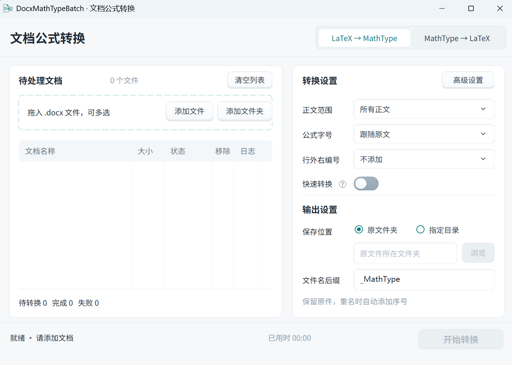
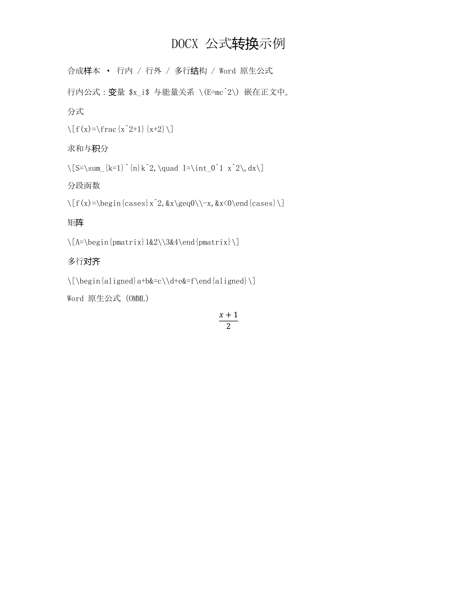
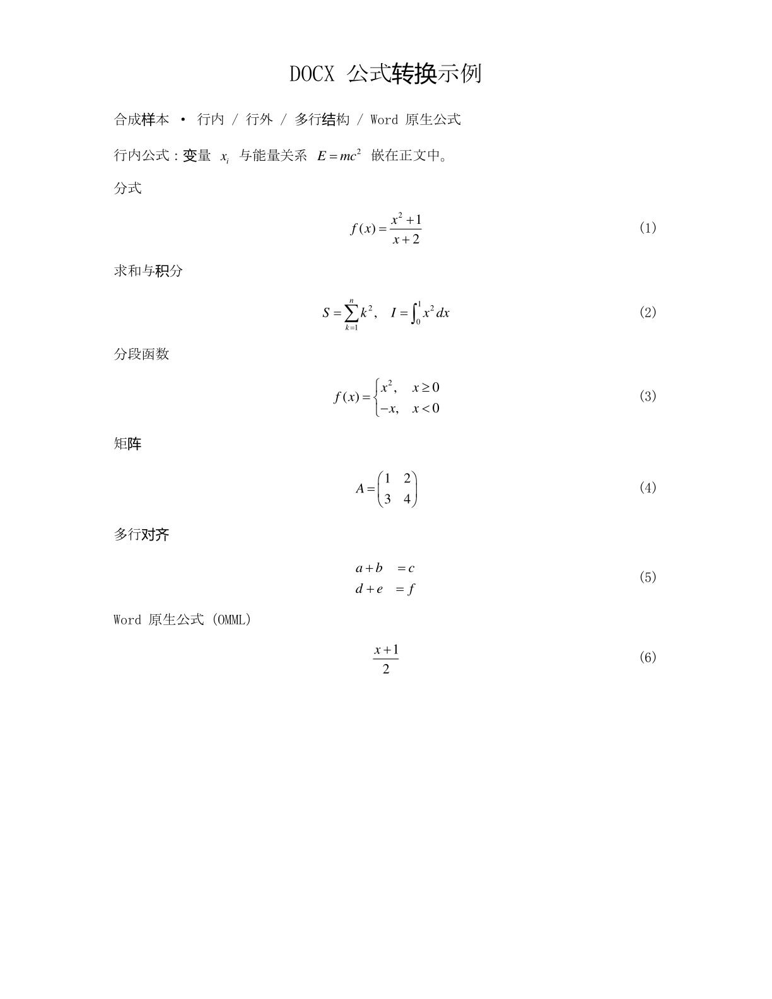

# DocxMathTypeBatch · MathType 批量转换器

**中文图形界面（GUI），解压即用。将 Word 文档中的 LaTeX 和原生公式批量转成可双击编辑的 MathType。**

整理论文、毕业设计或技术报告时，拖入 DOCX，点击“开始转换”即可。默认设置轻松上手，也能按需调整字号、行距和公式编号，或交给 AI Agent Skill 自动处理。

**[立即下载 Windows 中文界面版（ZIP）](https://github.com/yuxmic/DocxMathTypeBatch/releases/download/v0.1.4/DocxMathTypeBatch-v0.1.4-win-x64.zip)** · [下载 AI Agent Skill](https://github.com/yuxmic/DocxMathTypeBatch/releases/download/v0.1.4/docx-latex-to-mathtype-skill-v0.2.1.zip) · [使用说明](docs/使用说明.md)

运行前需安装 **64 位桌面 Word 和完整 MathType**，使用 Windows 10 / 11 x64。本工具免费开源，提供现成 EXE，无需编程或配置开发环境。

## 为什么用它

| 你关心的 | 程序提供的 |
| --- | --- |
| **小白也能上手** | 中文 UI，拖入文档即可按默认设置转换，问题提供中文原因和处理建议 |
| **开箱即用** | ZIP 解压后双击 EXE，无需安装 Python、PowerShell、.NET 或额外 VC++ 运行库 |
| **批量省时** | 多文档队列、添加文件夹，一次处理多份 DOCX。本机合成样本实测，100 个简单 LaTeX 公式常规转换约 45 秒 |
| **选项丰富** | 转换范围、Word 原生公式开关、行内/行外字号、行距、章/节/起始序号和右编号格式均可设置 |
| **支持 AI Skill** | 提供内含转换器的完整 Skill，用自然语言要求本机 Agent 完成批量转换 |
| **结果方便继续用** | 生成可编辑 MathType 对象，另存新文档保留原件，支持基本的 MathType → LaTeX 反向导出 |

## 三步开始

1. **下载并打开**。解压上方 ZIP，双击 `DocxMathTypeBatch.exe`，进入中文界面。也可[单独下载 EXE](https://github.com/yuxmic/DocxMathTypeBatch/releases/download/v0.1.4/DocxMathTypeBatch.exe)。
2. **拖入 Word 文档**。先保存并关闭文档，再拖入一个或多个 `.docx`，也可点击“添加文件夹”。
3. **点击“开始转换”**。默认设置即可使用，完成后双击列表中的文档打开结果，新公式可在 Word 中双击编辑。

默认转换所有正文，字号和行距跟随原文，右编号和快速转换关闭。需要统一格式时再调整选项。输出重名时自动添加序号。

首次运行可能出现 Windows 未签名程序提示。转换期间请避免同时操作 MathType，以免中断转换服务。详细步骤见[使用说明](docs/使用说明.md)。

## 转换效果

LaTeX 文本和 Word 原生公式转换后，可继续在 MathType 中编辑。需要公式编号时，可生成 MathType 原生右编号。

| 转换前 | 转换后 |
| --- | --- |
|  |  |

上图来自同一份合成文档的实际 Word 渲染，包含行内式、分式、求和、积分、分段函数、矩阵和多行公式。

## 实测速度

**100 个简单 LaTeX 公式，常规模式约 45 秒，快速模式约 22 秒。**

| 合成样本 | 常规模式 | 快速模式 |
| --- | --- | --- |
| 20 个 LaTeX 分式 / 80 段 | 约 12 秒 | — |
| 20 个 Word 原生分式 / 80 段 | 约 13 秒 | — |
| 100 个简单 LaTeX 公式 / 400 段 | 约 45 秒 | 约 22 秒 |

数据来自 2026-11-03 本机单轮实测，包含 Word 启动、转换、保存和退出清理。常规模式保留逐式及保存后核验，快速模式省略这些核验，输出需自行检查。实际耗时随公式复杂度、文档和机器环境变化。完整环境、精确计时和核验记录见[实测报告](docs/实测报告.md)。

## 按需调整公式格式

可选择全部正文、仅行内或仅行外公式，分别设置行内/行外字号和段落行距。行外右编号支持章号、节号、起始序号和格式预览，也可补充或更新已有 MathType 原生编号。章、节值由用户指定。

高级设置提供 Word 原生公式（OMML）转换开关，以及表格、文本框、页眉页脚、脚注尾注的实验性转换。额外位置只替换公式，设置方法与适用范围见[使用说明](docs/使用说明.md)。

查看高级设置界面

设置在当前程序会话中保留，重启后恢复默认。

## AI Agent Skill

安装完整 Skill 后，可直接向本机 Agent 提出要求。

> 将这份 DOCX 的公式转成 MathType，正文行外公式添加右编号，结果另存为新文件。

1. [下载完整 Skill v0.2.1](https://github.com/yuxmic/DocxMathTypeBatch/releases/download/v0.1.4/docx-latex-to-mathtype-skill-v0.2.1.zip)，将其中的 `docx-latex-to-mathtype` 文件夹放入所用 Agent 的 Skill 目录并重新加载。
2. 向 Agent 提供文档和转换要求。本机需安装 Word、MathType，并支持运行 Windows PowerShell 5.1 或 PowerShell 7 脚本。

完整包内含 v0.1.4 转换器 EXE，可随整个文件夹移动。日常图形界面使用直接下载 Windows 程序包。安装与调用详情见[Agent 使用说明](docs/使用说明.md#使用-agent-自动调用)和[Skill 调用参数](skills/docx-latex-to-mathtype/references/cli.md)。

## 运行环境与支持范围

| 项目 | 要求或说明 |
| --- | --- |
| Windows | Windows 10（1703 及以上）或 Windows 11，x64 |
| Word / MathType | 已正确安装并注册的 64 位桌面 Microsoft Word、完整 MathType，包含适配 64 位 Word 的组件 |
| LaTeX 输入 | 正文中使用 `$...$`、`$$...$$`、`\(...\)` 或 `\[...\]` 的公式 |
| Word 原生公式 | 默认与 LaTeX 一起转换，可在高级设置关闭 |
| 反向导出 | 支持 MathType → LaTeX，可选择行外定界符，保留 Word 原生公式 |

LaTeX 以 ASCII 公式为基础，支持常见命令与多行结构的兼容适配。公式独占段落时按行外处理，夹在正文中时按行内处理。中文正文保留，适配后仍含不支持字符的公式保留原式。完整写法见[公式书写与兼容性](docs/MathType兼容LaTeX书写规范.md)。

遇到“部分完成”时，可在“日志”中查看问题公式的原文页码、片段、原因及建议。高公式显示不全时可调整行距，过长公式需自行调整。修订、限制编辑及实验性位置的处理说明见[使用说明](docs/使用说明.md)。

## 文档与反馈

[使用说明](docs/使用说明.md) · [公式兼容性](docs/MathType兼容LaTeX书写规范.md) · [实测报告](docs/实测报告.md) · [更新记录](CHANGELOG.md) · [开发说明](docs/轻量化转换大纲.md) · [参与贡献](CONTRIBUTING.md)

欢迎通过 [Issues](https://github.com/yuxmic/DocxMathTypeBatch/issues) 反馈问题。请提供程序、Windows、Word、MathType 版本和复现步骤，示例、截图及日志提交前请去除私人信息。

本工具采用 [MIT 许可证](LICENSE)，允许使用、修改、分发和商用，须保留版权及许可声明。Microsoft Word 和 MathType 的使用遵循各自许可条款。
