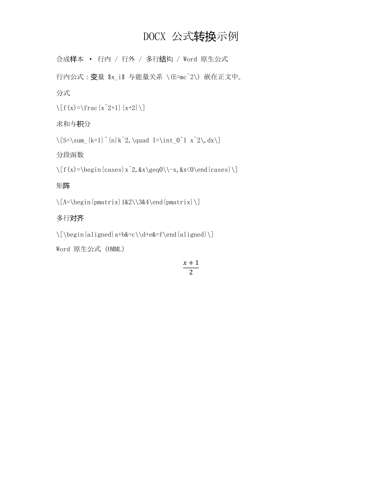
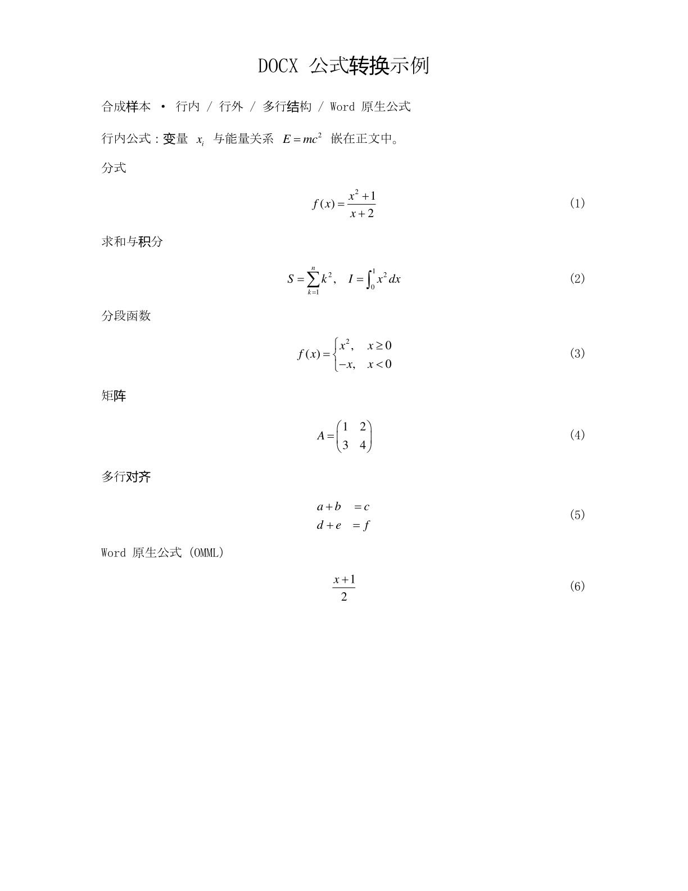

# 转换实测报告

本页记录 **2026-11-03** 对 DocxMathTypeBatch **v0.1.4** 的本机实测，覆盖 LaTeX、Word 原生公式（OMML）、标准与快速模式，以及含多种公式结构的正反向转换。全部使用合成文档，不含私人论文或实际业务数据。

本轮标准模式成功完成 20 式、100 式和混合结构样本；100 个简单行外式所在的 400 段文档端到端耗时 **45.466 秒**，同一输入的快速模式耗时 **21.881 秒**。快速模式省略核验，两项耗时对应不同的结果保障，不能作为同等核验质量下的性能比较。

[机器可读结果](benchmarks/2026-11-03.json) · [返回首页](../README.md)

## 测试环境

| 项目 | 本轮环境 |
| --- | --- |
| 程序 | DocxMathTypeBatch v0.1.4，Windows x64 |
| 操作系统 | Windows 11 家庭版中文版，Build 26300 |
| 处理器 | Intel Core i7-11800H @ 2.30 GHz，16 个逻辑线程 |
| 内存 | 16 GiB |
| Word | 64 位桌面版，16.0.14334.20974 |
| MathType | 产品版本 7.4.2.480；文件版本 2019.03.14.480 |
| 程序 SHA-256 | `CBA5D558A0DB93EDFCC8605941E52901F055F73F22B3C30637A77178DD977FB8` |

本轮 `build/bin/DocxMathTypeBatch.exe` 与 v0.1.4 发布目录、配套 Skill 中的 EXE 哈希一致。

## 计时方法与结果

使用现有 [test-pressure-performance.ps1](../tests/test-pressure-performance.ps1) 计时，显式传入同一批输入文件。计时从启动转换进程开始，到监管进程退出结束，**包含启动、Word 处理与保存、标准模式保存后重开核验和退出清理**；不包含编译、样本生成、独立 DOCX 包审计和图片渲染。这是用户任务的端到端耗时，不是转换引擎的纯计算时间。

每个配置采用 **1 次成功运行**，未计算多轮均值、方差或冷启动分布。字号和行距均跟随原文，额外位置转换关闭；除效果展示样本外均不添加编号。

| 合成样本 | 模式 | 成功 / 目标 | 端到端耗时 | 结果核验 |
| --- | --- | ---: | ---: | --- |
| 20 个 LaTeX 分式 / 80 段 | 标准 | 20 / 20 | 11.673 秒 | 保存后重开及内容、资产核验通过 |
| 20 个 OMML 分式 / 80 段 | 标准 | 20 / 20 | 13.417 秒 | 保存后重开及内容、资产核验通过 |
| 100 个简单 LaTeX 行外式 / 400 段 | 标准 | 100 / 100 | 45.466 秒 | 保存后重开及内容、资产核验通过 |
| 同一份 100 式 / 400 段输入 | 快速 | 100 / 100 | 21.881 秒 | 程序按快速路径保存，未经标准核验 |
| 8 个混合结构公式，开启右编号 | 标准 | 8 / 8 | 10.535 秒 | 保存后重开及内容、资产核验通过；新增 6 个右编号 |

两个 20 式样本具有相同分式结构和段落位置，来源分别为 LaTeX 与 OMML。100 式样本使用重复的简单表达式 `x_1+1`，耗时不能直接外推到 100 个大型矩阵或复杂嵌套公式。

四个标准模式运行均报告 `COMPLETE`，原文件字节保持不变、保存后 Word 重开核验通过，没有失败、拒绝或未尝试项。所有已完成输出另经 [audit_docx.py](../tests/helpers/audit_docx.py) 独立检查 ZIP、XML、关系引用及 OLE 容器和预览绑定。该独立检查不补齐快速模式省略的逐式与保存后核验，也不验证数学等价。

### 运行中断记录

100 式标准模式首轮在运行中报告 `MATHTYPE_SERVICE_DISCONNECTED`，以退出码 125 结束。当时用户正在另外使用 MathType；停止该外部操作后，对同一输入重新运行，100 / 100 成功，耗时即表中的 45.466 秒。

本轮将此事件记为外部使用干扰期间的服务断开观察，未确认其具体根因。未把失败轮次混入成功耗时；重测时让任务独占 MathType 使用时段。

## 转换效果

混合样本包含 **7 个 LaTeX 公式和 1 个 OMML 公式**，覆盖两种行内定界符、分式、求和与积分、分段函数、矩阵和 `aligned` 多行对齐。标准模式转换后，独立包检查得到 **8 个 MathType OLE 对象、0 个剩余 OMML 公式**；6 个独立行外式均生成右编号，本次报告没有版式提醒。

下图由同一份合成文档在本机 Word 中实际导出。目视核对后，2 个行内式、分式、求和与积分、分段函数、矩阵、多行对齐和 OMML 转换结果均清楚，6 个右编号位置正常，本页没有看到裁切或重叠。原文中的 LaTeX 文本、OMML 公式与转换后的 MathType 显示效果可直接比较。

| 原文 | 转换后 |
| --- | --- |
|  |  |

本轮还将上述正向结果通过配套 Skill 的 `ToLatex` 方向反向导出，**8 / 8 成功**，报告为 `COMPLETE`，原件核验与标准保存后重开核验通过；独立检查得到输出中 MathType 与 OMML 对象均为 0。Word 导出页面显示 8 式均已变为 LaTeX 文本，原生右编号 `(1)`–`(6)` 仍保留。反向文本由 MathType 翻译器生成，可能使用更多花括号、`array` 等写法，不保证逐字符还原输入源码。

对象数量、文档完整性核验和渲染图分别说明结构结果与显示效果；本轮未进行逐式数学等价证明。截图展示的结构范围也不代表所有 LaTeX 命令、所有文档容器或所有 Word/MathType 版本均已覆盖。

## 复现四个计时场景

在仓库根目录使用 **PowerShell 7**，本机需已安装 Word、MathType 和开发用 Python 依赖。准备好 `build/bin/DocxMathTypeBatch.exe`；从源码开始时，先按[开发说明](轻量化转换大纲.md)构建。复现前结束手动编辑 MathType 的操作，避免与任务共享服务发生干扰。

以下命令只生成一次合成样本，然后显式指定每次输入，结果保存在独立目录中。生成器为 [test_lightweight_fixtures.py](../tests/helpers/test_lightweight_fixtures.py)，本次使用其中的两个 20 式样本及 100 式样本。

```powershell
# 新建本轮目录，保留所有输入、输出、报告和计时证据。
$run = Join-Path 'tests/output' ('benchmark-' + (Get-Date -Format 'yyyyMMdd-HHmmss'))
$fixtures = Join-Path $run 'fixtures'
New-Item -ItemType Directory -Path $run, $fixtures | Out-Null
python -B -X utf8 tests/helpers/test_lightweight_fixtures.py $fixtures

# 20 个 LaTeX 分式，标准模式，不编号。
pwsh -NoProfile -File tests/test-pressure-performance.ps1 `
  -RunDirectory $run -Version Current -Round 1 -NoNumbers `
  -InputFile (Join-Path $fixtures 'performance-latex-20-80.docx')

# 20 个 OMML 分式，标准模式，不编号。
pwsh -NoProfile -File tests/test-pressure-performance.ps1 `
  -RunDirectory $run -Version Current -Round 1 -NoNumbers `
  -InputFile (Join-Path $fixtures 'performance-omml-20-80.docx')

# 100 个简单 LaTeX 行外式，标准模式，不编号。
pwsh -NoProfile -File tests/test-pressure-performance.ps1 `
  -RunDirectory $run -Version Current -Round 1 -NoNumbers `
  -InputFile (Join-Path $fixtures 'performance-100-400.docx')

# 同一份 100 式样本，快速模式，结果未经标准核验。
pwsh -NoProfile -File tests/test-pressure-performance.ps1 `
  -RunDirectory $run -Version Current -Round 1 -NoNumbers -FastConversion `
  -InputFile (Join-Path $fixtures 'performance-100-400.docx')
```

脚本输出 `*.timing.json`、`*.report.json`、日志和转换后的 DOCX。再次运行同一配置时使用新的目录或递增 `-Round`，避免覆盖既有证据。`Current` 表示使用本地 `build/bin` 中的程序，并不自动下载或切换版本；比较结果时应记录实际程序哈希、设置与输入文档。

原始运行文件含本机路径，仅留在忽略的 `tests/output/` 目录；公开的[机器可读结果](benchmarks/2026-11-03.json)保留计时、环境、计数和哈希，便于核对本页数据。

